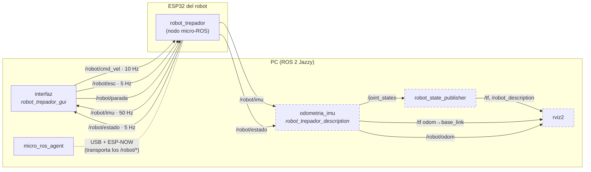
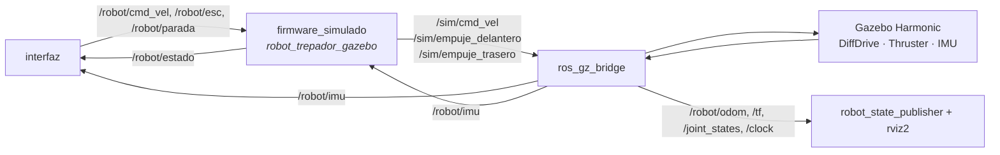
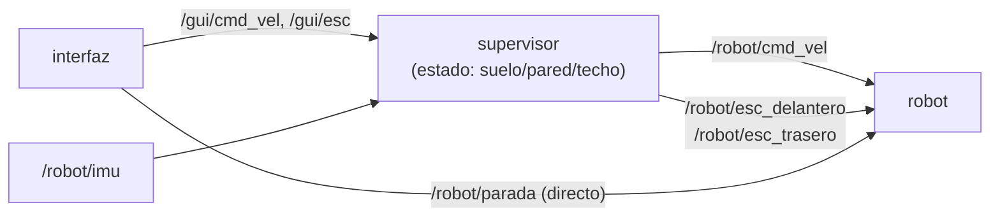

# Arquitectura del sistema

El operador maneja el robot desde la interfaz del PC. Las órdenes viajan como tópicos de ROS 2 hasta el
agente de micro-ROS, que las pasa por USB a la ESP32 puente, y esta por ESP-NOW (sin WiFi ni router)
a la ESP32 del robot. **Todas las protecciones viven en el robot**: si el PC, el agente o el enlace
fallan, el propio ESP32 apaga las hélices y frena las ruedas.

```
[PC: ROS 2 + interfaz + micro_ros_agent] ⇄ USB 921600 ⇄ [ESP32 puente] ⇄ ESP-NOW ⇄ [ESP32 robot: nodo micro-ROS]
```

## 1. Grafo de nodos y tópicos

Flecha = tópico ROS 2, apunta al suscriptor. Las cajas punteadas solo existen con `rviz:=true`.



### En simulación (Gazebo)

`firmware_simulado` ocupa el lugar del ESP32 (mismo nombre de nodo y mismos tópicos) y traduce las
órdenes a Gazebo. La interfaz no cambia.



## 2. Nodos

| Nodo | Dónde | Paquete / carpeta | Qué hace |
|---|---|---|---|
| `robot_trepador` | ESP32 del robot | `firmware/robot_receptor` | Recibe las órdenes y acciona los ESC (IO18) y el DRV8833. Lee el MPU6050 y calcula la orientación (filtro de Mahony). Aplica las protecciones (sección 4). |
| — (sin ROS) | ESP32 puente | `firmware/puente_pc` | Copia bytes entre el USB y ESP-NOW. No interpreta nada. |
| `micro_ros_agent` | PC | externo | Conecta el nodo del ESP32 con ROS 2 por el puerto serie. |
| `interfaz` | PC | `robot_trepador_gui` | Ventana Tkinter: ruedas, hélices, parada y vista 3D de la IMU. Reenvía las órdenes periódicamente para mantener vivos los timeouts del robot. |
| `odometria_imu` | PC | `robot_trepador_description` | Solo con el robot real y `rviz:=true`. Orientación desde la IMU y avance desde el PWM reportado. Publica TF, odometría y estado de las articulaciones. |
| `robot_state_publisher` | PC | ROS 2 | Publica el modelo URDF y sus TF. |
| `firmware_simulado` | PC | `robot_trepador_gazebo` | Solo en simulación: reproduce el firmware y manda velocidades y empuje a Gazebo. |

## 3. Tópicos

| Tópico | Tipo | Publica | Se suscribe | Para qué |
|---|---|---|---|---|
| `/robot/cmd_vel` | `geometry_msgs/Twist` | interfaz | robot | `linear.x` (m/s) y `angular.z` (rad/s), lazo abierto |
| `/robot/esc` | `std_msgs/Int32` | interfaz | robot | µs del ESC: 1000 apaga; 1100–2000 con rampa |
| `/robot/ruedas` | `std_msgs/Float32MultiArray` | (pruebas a mano) | robot | `[izq, der]` de −1 a 1, PWM directo |
| `/robot/parada` | `std_msgs/Bool` | interfaz | robot | Parada de emergencia enclavada |
| `/robot/imu` | `sensor_msgs/Imu` | robot | interfaz, odometria_imu | Orientación ya calculada en el robot. QoS de sensores (best effort) |
| `/robot/estado` | `std_msgs/String` (JSON) | robot | interfaz, odometria_imu | Lo que el robot realmente aplicó (ESC, PWM, IMU, enlace) |
| `/robot/odom` | `nav_msgs/Odometry` | odometria_imu / Gazebo | rviz2 | Pose 3D (estimada con el robot real, exacta en Gazebo) |
| `/robot/odom_reiniciar` | `std_msgs/Bool` | (a mano) | odometria_imu | Pone la posición a cero |
| `/joint_states` | `sensor_msgs/JointState` | odometria_imu / Gazebo | robot_state_publisher | Giro de ruedas y hélices |

El formato del JSON de `/robot/estado` está en [firmware.md](firmware.md).

## 4. Seguridad

| Situación | Qué pasa | Dónde |
|---|---|---|
| No llega `/robot/esc` en 2 s | Hélices a 1000 µs | ESP32 |
| No llegan órdenes de ruedas en 0,5 s | Ruedas frenadas | ESP32 |
| Se pierde el agente o ESP-NOW (3 pings) | Todo apagado y reconexión automática | ESP32 |
| PARADA (botón o espacio) | Apaga todo y bloquea hasta LIBERAR | ESP32 (enclavada) |
| Arranque | ESC a 1000 µs durante 3 s (armado), ruedas frenadas | ESP32 |
| Se cierra la interfaz | Manda apagar antes de salir; si no alcanza, actúan los timeouts | PC + ESP32 |

Al estar en el robot, las protecciones funcionan aunque falle cualquier cosa del lado del PC.
Hacen el mismo trabajo que un "heartbeat": la interfaz reenvía las órdenes cada 0,1–0,2 s.

## 5. Próximo paso: supervisor (idea tomada de Carro_trepador)

El robot de referencia ([juanscastano-maker/Carro_trepador](https://github.com/juanscastano-maker/Carro_trepador))
propone un nodo supervisor entre la interfaz y el robot: la interfaz pide, y el supervisor solo deja pasar
lo que es seguro según el estado (suelo, pared, techo, parada). Hoy no hace falta, porque todo es manual.
Sirve cuando el robot tenga que **pasar solo del suelo a la pared**:



Requisitos antes de hacerlo:
1. **Un pin por ESC** (hoy los dos comparten IO18). Ver [hardware/README.md](../hardware/README.md).
2. Detectar la pared con la IMU y repartir el empuje: delantera casi a cero, trasera al máximo
   ([fisica_transiciones.md](fisica_transiciones.md)).
3. Reglas del supervisor, por ejemplo: no dejar bajar las hélices del 90 % mientras el robot esté en la
   pared o en el techo.

La parada de emergencia seguiría yendo directo al robot, sin pasar por el supervisor.
