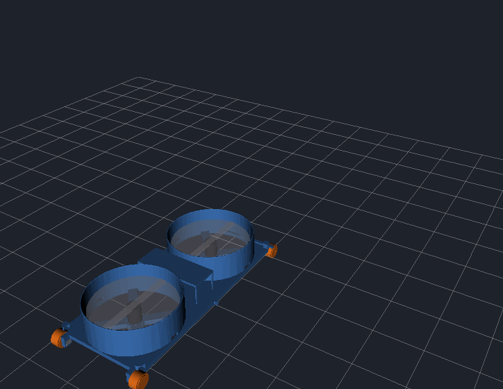

# Simulación (Gazebo) y visualización (RViz)

Requiere ROS 2 Jazzy o Humble y Gazebo Harmonic (`scripts/instalar_dependencias.sh` instala todo).
Paquetes: `robot_trepador_description` (modelo URDF, RViz) y `robot_trepador_gazebo` (mundo, puente, firmware simulado).
El grafo de nodos está en [arquitectura.md](arquitectura.md).

## Robot real en RViz

```bash
ros2 launch robot_trepador_gui robot.launch.py puerto:=/dev/ttyUSB0 rviz:=true
```

El modelo 3D se orienta con la IMU y avanza con el PWM que el robot reporta en `/robot/estado`
(nodo `odometria_imu`). La orientación es real; la posición es una estimación (sin encoders se
desvía con el tiempo y el yaw deriva). Para poner la posición a cero:
`ros2 topic pub --once /robot/odom_reiniciar std_msgs/msg/Bool "{data: true}"`.

## Simulación en Gazebo (sin el robot)

```bash
ros2 launch robot_trepador_gazebo simulacion.launch.py
```

Abre Gazebo con la habitación (pared a 0,8 m delante, techo a 1 m), RViz y **la misma interfaz**.
El nodo `firmware_simulado` hace lo que haría el ESP32: armado de 3 s, rampa del ESC, timeouts,
parada de emergencia, PWM mínimo de los N20 y `/robot/estado` con el mismo JSON. Así la interfaz
no sabe si habla con el robot o con Gazebo.

Opciones: `rviz:=false`, `interfaz:=false`, `gazebo_gui:=false` (solo servidor),
`empuje_max_n:=12.0` (N por hélice a 1700 µs, el máximo permitido), `bat_celdas:=2 bat_mah:=2200 bat_carga_inicial:=0.95`
(batería simulada: se descarga según el acelerador; con `bat_carga_inicial:=0.15` ves los avisos), `x:= y:= yaw:=` (dónde aparece),
`reparto_delantera:=0.0` (apaga la hélice delantera y deja la trasera; hoy los ESC van en
paralelo, así que el robot real siempre usa 1.0).

### El modelo



El chasis son tus dos bases impresas, versión v2 con la nariz (`hardware/cad/Base_2_v2.STL` y su espejo), una delante de la otra y
unidas por las repisas: 450 × 216 × 70 mm. Cada base tiene su ducto con un A2217 y 2 llantas JSumo SLT20
(Ø33 × 21 mm) que sobresalen 20 mm por delante y por detrás. Todo se ajusta arriba de `robot_trepador.urdf.xacro`:

| Medida | Valor | Propiedad |
|---|---|---|
| Llantas | Ø33 × 21 mm (banda 18 mm), fricción 1,0 | `r_rueda`, `ancho_rueda`, `mu_rueda` |
| Distancia entre ejes | 457 mm (llantas 20 mm por fuera del chasis) | `saliente_rueda` |
| Vía (centro a centro) | 195 mm | sale de `ancho` − `ancho_rueda` |
| Eje bajo la placa | 5 mm, así la placa queda a 21,5 mm del suelo | `eje_bajo_placa` |
| Ductos | centros a ±127 mm, Ø195 mm | `ducto_x`, `ducto_r` |
| Hélices | 7" (178 mm) a 45 mm de la placa | `d_helice`, `altura_helice` |
| Masa | 1,32 kg con los pesos medidos (`hardware/lista_materiales.md`) | `masa_bases`, `masa_electronica`, ... |
| Par de cada N20 | 0,2 N·m | `par_rueda` |
| Empuje | 8,9 N por ducto a 1700 µs (909 gf medidos), cae con el cuadrado del voltaje | argumento `empuje_max_n` (y el parámetro `empuje_v_ref` del nodo, 11,5 V) |
| Batería | 3S 2200 mAh, 23 A por motor a 1700 µs | `bat_celdas`, `bat_mah` |

Para Gazebo, los choques usan formas simples (la placa como caja y los ductos como cilindros), que son
más rápidas y estables que la malla; lo que ves es la malla real.

Los soportes de los N20 están en la Base v2. Si cambias la saliente en `herramientas/cad/base_v2.py`,
cambia también `saliente_rueda` en el URDF.

**Probar en la pared:** pon las hélices al máximo con el robot en el suelo y luego colócalo en la pared:

```bash
gz service -s /world/habitacion/set_pose --reqtype gz.msgs.Pose --reptype gz.msgs.Boolean \
  --timeout 3000 --req 'name: "escalador", position: {x: 0.778, z: 0.4}, orientation: {w: 0.7071, y: -0.7071}'
```

Se sostiene con las hélices y sube con ▲ hasta la esquina del techo.

**Probar en el techo** (boca abajo, con las hélices ya en 1700 µs):

```bash
gz service -s /world/habitacion/set_pose --reqtype gz.msgs.Pose --reptype gz.msgs.Boolean \
  --timeout 3000 --req 'name: "escalador", position: {x: 0.0, z: 0.978}, orientation: {w: 0.0, x: 1.0}'
```

Se queda pegado al techo y avanza con ▲ hasta la pared. Si bajas las hélices, se cae.

**Volver al suelo:**

```bash
gz service -s /world/habitacion/set_pose --reqtype gz.msgs.Pose --reptype gz.msgs.Boolean \
  --timeout 3000 --req 'name: "escalador", position: {x: 0.0, z: 0.03}, orientation: {w: 1.0}'
```

### Qué reproduce Gazebo y qué no

Probado con el modelo de tus dos bases v2 y los pesos reales (1,32 kg, 8,9 N por ducto):

| Prueba | Resultado en Gazebo |
|---|---|
| Andar por el suelo, girar, hélices con rampa y tope de 1700 µs, parada | ✔ |
| Quedarse pegado a la pared y subir por ella hasta el techo | ✔ |
| Quedarse pegado al techo y avanzar | ✔ |
| Llegar a la pared andando | Se queda contra la pared: las llantas y el borde de la placa tocan la pared a la vez |
| Pasar del suelo a la pared o de la pared al techo (esquinas) | ✘ No se puede comprobar en Gazebo |

En las esquinas, el motor de contactos de Gazebo (DART) casi no da fricción cuando la rueda resbala
tocando dos superficies a la vez: la rueda delantera gira en falso. Con el modelo anterior se probó con
ruedas esféricas, más par, otro detector de colisiones, el motor Bullet y el solver PGS, sin que cambie
(o volviéndose inestable). Las transiciones hay que validarlas con el robot real o con MuJoCo
([fisica_transiciones.md](fisica_transiciones.md)).
