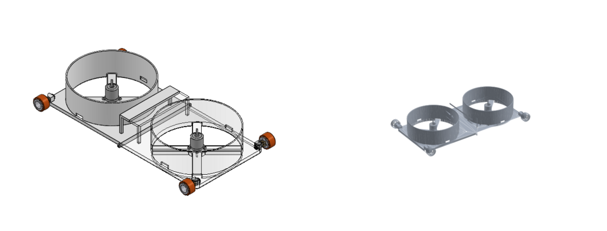
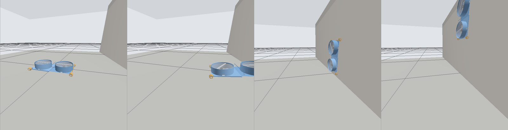

# Simulación (Gazebo) y visualización (RViz)

Requiere ROS 2 Jazzy o Humble y Gazebo Harmonic (`scripts/instalar_dependencias.sh` instala todo).
Paquetes: `robot_trepador_description` (modelo URDF, RViz) y `robot_trepador_gazebo` (mundo, puente, firmware simulado).
El grafo de nodos está en [arquitectura.md](arquitectura.md).

## Robot real en RViz

```bash
ros2 launch robot_trepador_gui robot.launch.py puerto:=/dev/ttyUSB0 rviz:=true
```

El modelo 3D se orienta con la IMU y avanza con el PWM que el robot reporta en `/robot/estado`
(nodo `odometria_imu`). La orientación es real; la posición es una estimación (sin encoders se
desvía con el tiempo y el yaw deriva). Para poner la posición a cero:
`ros2 topic pub --once /robot/odom_reiniciar std_msgs/msg/Bool "{data: true}"`.

## Simulación en Gazebo (sin el robot)

```bash
ros2 launch robot_trepador_gazebo simulacion.launch.py
```

Abre Gazebo con la habitación (pared a 0,8 m delante, techo a 1 m), RViz y **la misma interfaz**.
El nodo `firmware_simulado` hace lo que haría el ESP32: armado de 3 s, rampa del ESC, timeouts,
parada de emergencia, PWM mínimo de los N20 y `/robot/estado` con el mismo JSON. Así la interfaz
no sabe si habla con el robot o con Gazebo.

Opciones: `rviz:=false`, `interfaz:=false`, `gazebo_gui:=false` (solo servidor),
`empuje_max_n:=12.0` (N por hélice a 1700 µs, el máximo permitido), `bat_celdas:=2 bat_mah:=2200 bat_carga_inicial:=0.95`
(batería simulada: se descarga según el acelerador; con `bat_carga_inicial:=0.15` ves los avisos), `x:= y:= yaw:=` (dónde aparece),
`reparto_delantera:=0.0` (apaga la hélice delantera y deja la trasera; hoy los ESC van en
paralelo, así que el robot real siempre usa 1.0).

### El modelo

El URDF sale del ensamble de SolidWorks `hardware/cad/Diseno_2.SLDASM`: las mallas de la base, el soporte del
motor, el A2217 y la llanta se extrajeron de ese archivo y cada pieza está donde la pusiste en el ensamble
(cómo se hizo: `herramientas/cad/solidworks/README.md`).



| Medida | Valor | Propiedad o argumento |
|---|---|---|
| Robot completo | 468 × 260 × 71,5 mm | |
| Llantas SLT20 | Ø33 × 21 mm, por fuera de la placa, vía 239 mm | `rueda_y` |
| Ejes | ±217,5 mm del centro (ensamble) | argumento `rueda_x` |
| Altura | eje 15 mm por encima de la cara inferior; placa a 1,5 mm del suelo | `rueda_z` |
| Ductos y A2217 | centros a ±127 mm | `ducto_x` |
| Masa | 1,225 kg (`hardware/lista_materiales.md`) | `masa_bases`, `masa_electronica`, ... |
| Empuje | 8,9 N por ducto a 1700 µs, cae con el cuadrado del voltaje | `empuje_max_n` |
| Batería | 3S 2200 mAh, 23 A por motor a 1700 µs | `bat_celdas`, `bat_mah` |

**`rueda_x` en la simulación.** Por defecto la simulación usa `rueda_x:=0.225`: los ejes 7,5 mm más afuera
que en el ensamble, con el centro de cada llanta justo en el extremo de la placa. Con el valor del ensamble
(`rueda_x:=0.2175`) el robot **no sube a la pared**: la placa va a 1,5 mm del suelo y, al levantar la nariz,
la cola toca el suelo a unos 18° y las llantas traseras se despegan. RViz con el robot real usa el valor del
ensamble.

### Qué reproduce Gazebo y qué no



Probado con el ensamble Diseño 2, `rueda_x:=0.225`, 1,225 kg, 8,9 N por ducto, motor de física **Bullet** y `reparto:=auto`:

| Prueba | Resultado en Gazebo |
|---|---|
| Andar por el suelo, hélices con rampa y tope de 1700 µs, parada | ✔ |
| **Pasar del suelo a la pared andando** | ✔ (unos 4 s desde que la nariz toca la pared) |
| Lo mismo con los ejes del ensamble (`rueda_x:=0.2175`) | ✘ la cola toca el suelo a ~18° |
| Subir por la pared hasta la esquina del techo | ✔ |
| Quedarse pegado al techo y avanzar | ✔ |
| Pasar de la pared al techo | ✘ No alcanza el empuje (ver abajo) |
| Girar sobre sí mismo | Casi no gira (ver abajo) |

**Motor de física.** El mundo usa Bullet (Featherstone). Con DART, el que trae Gazebo por defecto, la
rueda que toca a la vez el suelo y la pared casi no recibe fricción de la pared y gira en falso, así que
el robot nunca pasa a la pared.

**Reparto de empuje (`reparto`).**
- `auto` (por defecto): simula que cada ESC tiene su pin. Mientras la IMU ve el robot en el suelo, la
  hélice delantera va apagada; en cuanto el robot pasa de 60° de inclinación, las dos van a fondo. Así sube.
- `igual`: las dos hélices al mismo acelerador, como el robot de hoy (ESC en paralelo en el IO18). Con
  este modo llega a la pared y **no** sube.

**Pared → techo.** En la pared, la fricción tiene que sostener los 12 N del robot con 2 × 8,9 N de
empuje. Si se baja la hélice delantera para que la nariz se despegue hacia el techo, el robot resbala
(probado: con la delantera apagada se cae, con la mitad resbala hasta el suelo). Hace falta más empuje
o menos peso: con empuje/peso de 1,48 no hay margen.

**Girar.** Las llantas están a 435–450 mm entre ejes y a 239 mm entre lados. Para girar, un robot de 4 ruedas
fijas tiene que arrastrarlas de lado, y con un robot tan largo y angosto casi no lo logra: en MuJoCo gira
unos 8° por segundo (el 14 % de lo que pide la interfaz), con o sin hélices; en Gazebo todavía menos.
El robot real va a girar mal. Opciones: girar mientras avanza, acercar las llantas al centro (menos
distancia entre ejes) o usar llantas con poca fricción lateral (omnidireccionales) en un eje.
