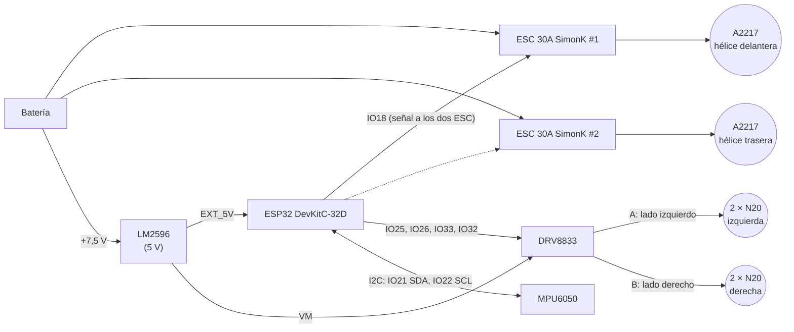

# Hardware

| Archivo | Qué es |
|---|---|
| `esquematico.jpg` | Esquemático de la placa del robot (KiCad) |
| `pcb_cobre.jpg` | Máscara de la capa de cobre para transferencia (está **en espejo**: así se imprime) |
| `lista_materiales.md` | Componentes, cantidades y peso |

> Sube aquí también los archivos de KiCad (`.kicad_pro`, `.kicad_sch`, `.kicad_pcb`) para poder editarlos.

## Diagrama de bloques

## Conexiones (según el esquemático)

| ESP32 | Va a | En el firmware (`config.h`) |
|---|---|---|
| IO18 | J1: señal de los ESC (los dos en paralelo) | `PIN_ESC 18` |
| IO25 | DRV8833 AIN1 | `PIN_AIN1 25` |
| IO26 | DRV8833 AIN2 | `PIN_AIN2 26` |
| IO33 | DRV8833 BIN1 | `PIN_BIN1 33` |
| IO32 | DRV8833 BIN2 | `PIN_BIN2 32` |
| IO21 | MPU6050 SDA | `PIN_SDA 21` |
| IO22 | MPU6050 SCL | `PIN_SCL 22` |
| 3V3 | MPU6050 VCC y DRV8833 STBY (driver siempre habilitado) | — |
| EXT_5V | Salida del LM2596 (también alimenta VM del DRV8833) | — |

Salidas del DRV8833: AOUT1 y AOUT2 → J2 pines 1 y 2 (N20 izquierdos); BOUT1 → J2 pin 3 y BOUT2 → J3 pin 1
(N20 derechos). Cada salida mueve **dos N20 en paralelo**.

Si un lado gira al revés, no hace falta tocar la placa: cambia `MOTOR_IZQ_INVERTIDO` o
`MOTOR_DER_INVERTIDO` en `firmware/robot_receptor/src/config.h`.

## Para revisar antes de fabricar la siguiente versión

- **IO0 cerca de J1.** En el esquemático hay un punto de unión a la altura del IO0 sobre la línea de la
  señal del ESC. Comprueba que el IO0 **no** esté conectado: es un pin de arranque y, si queda unido a
  la señal del ESC, la ESP32 puede no arrancar o entrar en modo de programación.
- **5 V compartidos.** La ESP32 y los 4 N20 (VM del DRV8833) salen del mismo LM2596. Si los motores se
  traban, la línea de 5 V puede caer y reiniciar la ESP32. Ayuda poner un condensador electrolítico
  grande (470–1000 µF) en VM, cerca del DRV8833.
- **Un pin por ESC.** Hoy los dos ESC comparten IO18, así que las dos hélices reciben siempre el mismo
  acelerador. Para el reparto de empuje que permite subir del suelo a la pared
  (`docs/fisica_transiciones.md`), lleva el segundo pad "ESC" de la PCB a un pin libre, por ejemplo el IO19.
- **Batería.** No hay divisor de tensión hacia la ESP32, así que el robot no puede avisar de batería baja.
  Un divisor (por ejemplo 100 k / 33 k) a un pin ADC1 libre, como el IO34, bastaría.
