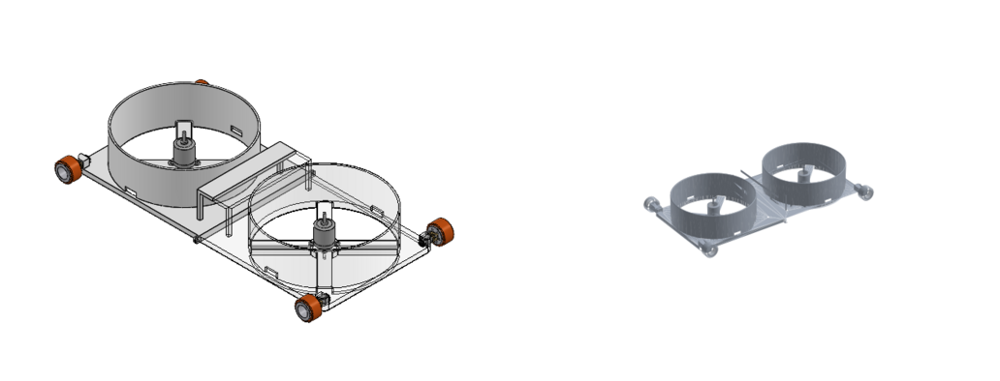
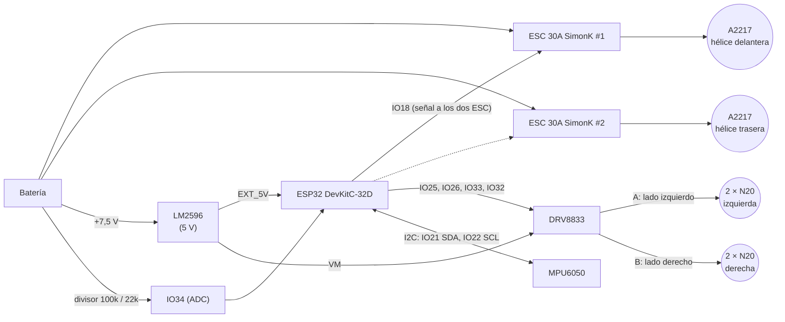

# Hardware

| Archivo | Qué es |
|---|---|
| `esquematico.jpg` | Esquemático de la placa del robot (KiCad) |
| `pcb_cobre.jpg` | Máscara de la capa de cobre para transferencia (está **en espejo**: así se imprime) |
| `lista_materiales.md` | Componentes, cantidades y peso |
| `cad/Diseno_2.SLDASM` | **Ensamble actual** (SolidWorks): de aquí sale el URDF (ver `herramientas/cad/solidworks/`) |
| `cad/Base_2.STL` | Base 2 sola (mm) |
| `cad/Base_2_v2.STL`, `cad/Base_1_v2.STL` | Propuesta anterior de nariz (llanta debajo de la placa, 20 mm adelante); quedó reemplazada por el ensamble |



**Cómo es el ensamble (Diseño 2):** dos Base 2 (la de atrás girada 180°) unidas por las repisas; un A2217 sobre
su `Agarre_motor` en el centro de cada ducto; cuatro llantas SLT20 **por fuera de la placa**, en las esquinas,
con el eje 15 mm por encima de la cara inferior de la placa y un N20 apoyado sobre el borde. La placa queda a
**1,5 mm del suelo** (efecto suelo). Robot completo: 468 × 260 × 71,5 mm, vía 239 mm, 435 mm entre ejes.

**Ojo con la cola de la placa.** Los ejes están 7,5 mm por dentro de los extremos de la placa. Como la placa va
casi pegada al suelo, al levantar la nariz contra una pared la cola toca el suelo a unos 18° y el robot pivota
sobre ella: las llantas traseras se despegan y no sube (probado en Gazebo). Con los ejes **7,5 mm más afuera**
(centro de cada llanta justo en el extremo de la placa) sí sube. Otra opción es redondear o biselar los
extremos de la placa por debajo.

> Sube aquí también los archivos de KiCad (`.kicad_pro`, `.kicad_sch`, `.kicad_pcb`) para poder editarlos.

## Diagrama de bloques



## Conexiones (según el esquemático)

| ESP32 | Va a | En el firmware (`config.h`) |
|---|---|---|
| IO18 | J1: señal de los ESC (los dos en paralelo) | `PIN_ESC 18` |
| IO25 | DRV8833 AIN1 | `PIN_AIN1 25` |
| IO26 | DRV8833 AIN2 | `PIN_AIN2 26` |
| IO33 | DRV8833 BIN1 | `PIN_BIN1 33` |
| IO32 | DRV8833 BIN2 | `PIN_BIN2 32` |
| IO21 | MPU6050 SDA | `PIN_SDA 21` |
| IO22 | MPU6050 SCL | `PIN_SCL 22` |
| IO34 | Divisor de tensión de la batería (**hay que agregarlo**, ver abajo) | `PIN_BATERIA 34` |
| 3V3 | MPU6050 VCC y DRV8833 STBY (driver siempre habilitado) | — |
| EXT_5V | Salida del LM2596 (también alimenta VM del DRV8833) | — |

Salidas del DRV8833: AOUT1 y AOUT2 → J2 pines 1 y 2 (N20 izquierdos); BOUT1 → J2 pin 3 y BOUT2 → J3 pin 1
(N20 derechos). Cada salida mueve **dos N20 en paralelo**.

Si un lado gira al revés, no hace falta tocar la placa: cambia `MOTOR_IZQ_INVERTIDO` o
`MOTOR_DER_INVERTIDO` en `firmware/robot_receptor/src/config.h`.

## Medición de la batería (agregar a la placa)

La interfaz muestra el voltaje y el porcentaje de la batería, pero la placa actual no tiene cómo
medirlo. Agrega un divisor de tensión al IO34 (puedes soldarlo al aire mientras haces la siguiente PCB):

```
 + batería ──[ R1 100 kΩ ]──┬── IO34
                            ├──[ R2 22 kΩ ]── GND
                            └──[ 100 nF ]──── GND
```

- Con la batería **3S** (12,6 V llena), en el IO34 quedan 2,27 V. El firmware ya viene configurado así
  (`BAT_CELDAS = 3`, `BAT_R2_OHM = 22000` en `firmware/robot_receptor/src/config.h`).
- Usa el IO34 (ADC1). Los pines del ADC2 no funcionan mientras la radio (ESP-NOW) está encendida.
- **Calibración:** mide la batería con un multímetro y compárala con lo que muestra la interfaz. Pon
  `BAT_CALIBRACION = multímetro / interfaz` (por ejemplo 7,90 / 7,78 = 1,015).
- Sin el divisor, la interfaz muestra "sin medición" y el robot funciona igual.

## Para revisar antes de fabricar la siguiente versión

- **IO0 cerca de J1.** En el esquemático hay un punto de unión a la altura del IO0 sobre la línea de la
  señal del ESC. Comprueba que el IO0 **no** esté conectado: es un pin de arranque y, si queda unido a
  la señal del ESC, la ESP32 puede no arrancar o entrar en modo de programación.
- **5 V compartidos.** La ESP32 y los 4 N20 (VM del DRV8833) salen del mismo LM2596. Si los motores se
  traban, la línea de 5 V puede caer y reiniciar la ESP32. Ayuda poner un condensador electrolítico
  grande (470–1000 µF) en VM, cerca del DRV8833.
- **Un pin por ESC.** Hoy los dos ESC comparten IO18, así que las dos hélices reciben siempre el mismo
  acelerador. Para el reparto de empuje que permite subir del suelo a la pared
  (`docs/fisica_transiciones.md`), lleva el segundo pad "ESC" de la PCB a un pin libre, por ejemplo el IO19.
- **Divisor de la batería** en el IO34, como se explica arriba.
